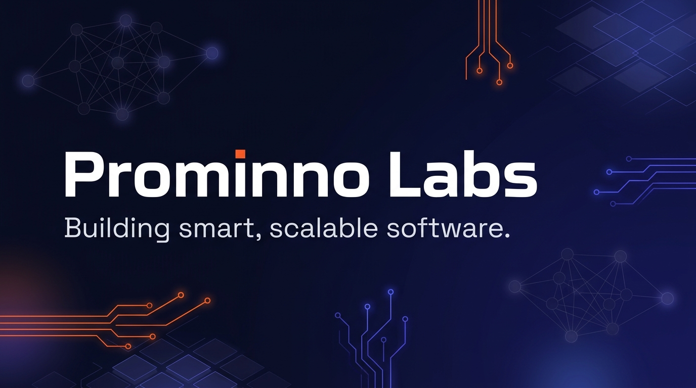

### Building smart, scalable software.

---

## 👋 About Us

**Prominno Labs** is a product-driven software company building modern web, mobile, and AI-powered solutions. From intelligent customer engagement platforms to field operations software, we craft tools that help businesses run smarter and scale faster.

This is where we share the tools, templates, and experiments we use ourselves. Issues, ideas, and pull requests are always welcome.

---

## 🚀 Our Products

### 💬 TheQuickAssist — WhatsApp CRM & AI Automation

**[thequickassist.co](https://thequickassist.co/)** — _All-in-One WhatsApp CRM, Workflow Automation & AI Chatbot Platform_

TheQuickAssist helps businesses manage customer interactions, capture leads, and automate support across WhatsApp and other channels — all without writing a single line of code.

**Key Features:**
- 🤖 **No-Code AI Chatbot & Agent Builder** — Build and deploy GPT-4-powered AI agents using a visual drag-and-drop workflow builder; train them on your own PDFs, documents, or website
- 📲 **WhatsApp Business Automation** — Connect your WhatsApp number via the Business API, run automated messaging workflows, and send bulk broadcast campaigns
- 🌐 **Omnichannel Deployment** — Deploy bots and support widgets across your website, WhatsApp, Facebook, and Instagram
- 🎯 **Lead Generation & Management** — Automate lead qualification, capture contact details inside chat, and sync everything back to your CRM
- 📅 **Smart Appointment Booking** — Let clients book meetings or consultations directly in chat with Google Meet and calendar integration
- 🗣️ **80+ Languages Supported** — The AI auto-detects and replies in the customer's language for global reach
- 👥 **Shared Team Inbox** — Manage conversations collaboratively, assign chats, use labels, and track activity from a unified dashboard or mobile app
- 🔗 **REST APIs & Webhooks** — Developer-friendly integrations for custom workflows, event triggers, and real-time delivery updates

---

### 📦 FRBilling — Courier Billing & Management Software

**[frbilling.com](https://frbilling.com/)** — _Cloud-Based Billing & Operations Software for Courier Businesses_

FRBilling is a cloud-based billing, invoicing, and operations management platform built specifically for courier franchises and logistics service providers. It acts as a digital virtual assistant to automate daily logistics workflows and eliminate manual errors.

**Key Features:**
- 📬 **Easy Courier Booking & Billing** — Manage daily cash and billing bookings with bulk booking capabilities; reduce manual data entry and human calculation errors
- 🧾 **GST-Compliant Invoice Generation** — Generate professional, GST-ready delivery bills with barcode-enabled receipts; customize with your logo and email directly to clients
- 💰 **Flexible Rate Master Management** — Configure custom pricing for different destinations, clients, or service tiers with automated rate calculations
- 💳 **Payment & Expense Tracking** — Monitor incoming collections, outgoing expenses, and maintain a clear view of billed vs. pending deliveries
- 📈 **Reporting & Analytics** — Access daily payment reports, creditor reports, booking insights, and automated P&L statements comparing franchise earnings against courier charges
- 🏢 **Franchise & Role-Wise Management** — Multi-franchisee support with role-based feature permissions for admins, cash counters, employees, and customer modules
- 📦 **Stationery Inventory Management** — Track office and packing supplies with reminders so you never run out of essentials
- 🔍 **Booking Reconciliation** — Cross-examine booking discrepancies, review weight differences, and ensure data integrity

---

## 🛠️ Our Tech Stack

**Backend & .NET**

**AI & Machine Learning**

**Frontend & Mobile**

**Cloud, Data & DevOps**

---

## 📂 Our Products

| Product | Description |
| --- | --- |
| [**TheQuickAssist**](https://thequickassist.co/) | WhatsApp CRM, AI chatbot & workflow automation platform |
| [**FRBilling**](https://frbilling.com/) | Cloud-based billing & operations software for courier franchises |

---

## 🤝 Contributing

We love community contributions.

1. Browse issues labelled [`good first issue`](https://github.com/search?q=org%3AProminnoLabs+label%3A%22good+first+issue%22+state%3Aopen&type=issues) or [`help wanted`](https://github.com/search?q=org%3AProminnoLabs+label%3A%22help+wanted%22+state%3Aopen&type=issues).
2. Fork the repo, create a branch, and open a pull request.
3. Read the `CONTRIBUTING.md` in each repository before you start.

Found a bug or have an idea? Open an issue in the relevant repo or start a conversation in its **Discussions** tab.

---

## 📬 Connect With Us

- 🌐 Website: [prominno.com](https://prominno.com/)
- ✉️ Email: [info@prominno.com](mailto:info@prominno.com)
- 💼 LinkedIn: [Prominno Labs](https://www.linkedin.com/company/prominno-labs-private-limited/)
- 🐦 X: [@Prominno_pvt](https://x.com/Prominno_pvt)
- 📸 Instagram: [@prominnopvtltd](https://www.instagram.com/prominnopvtltd/)
- 👍 Facebook: [Prominno Pvt Ltd](https://www.facebook.com/people/Prominno-Pvt-Ltd/61582716781527/)

---

⭐ If you find our projects useful, please star them — it helps a lot!

